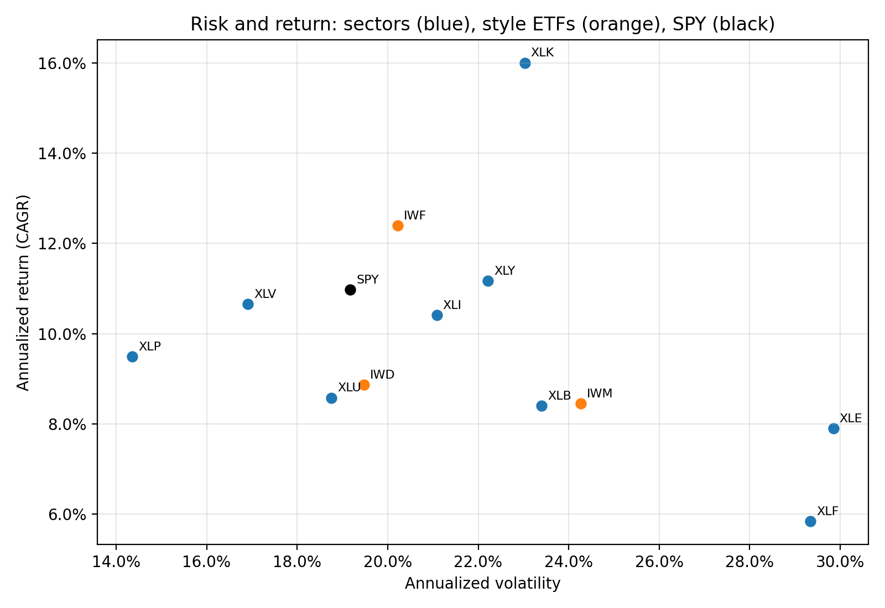
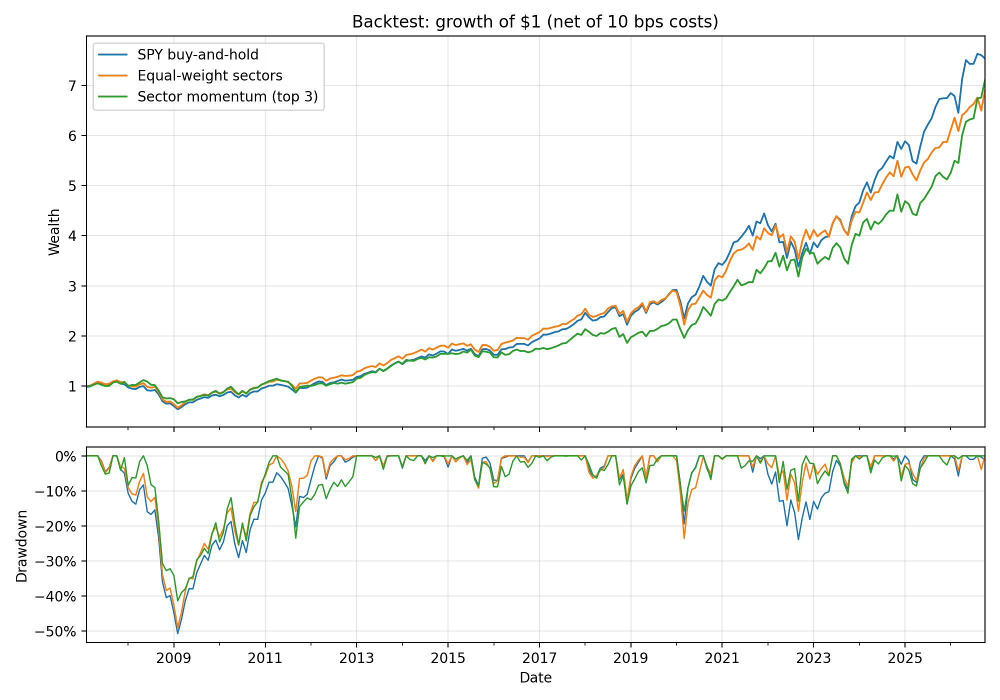
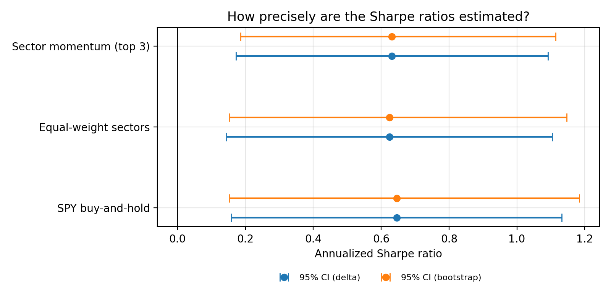
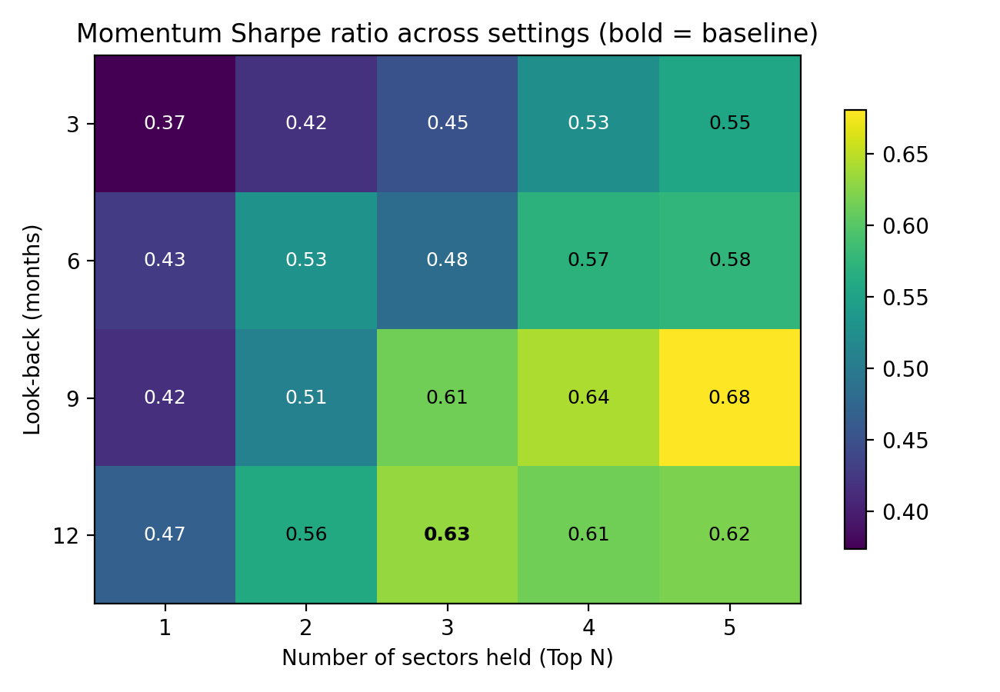
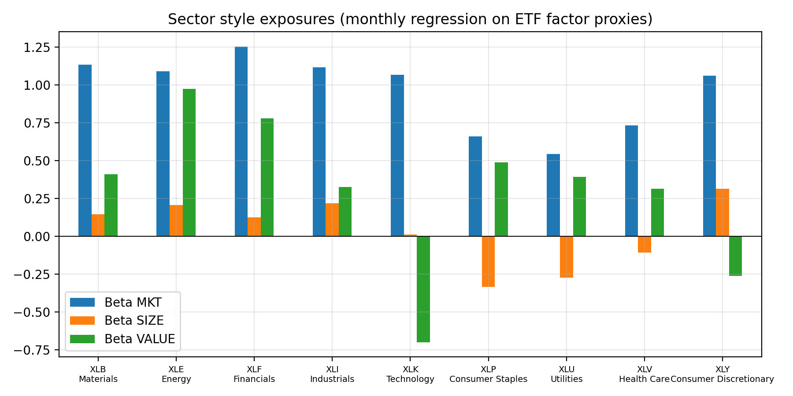

# U.S. Sector ETF Analysis


*Independent personal project using public market data. Not investment advice and not professional investment experience.*

## Question

How do the nine U.S. sector ETFs differ in risk, return and style exposure, and does a simple
sector momentum rule beat the S&P 500 once costs **and statistical uncertainty** are taken into account?

## Data

| Source | Series | Use |
|---|---|---|
| Yahoo Finance (`yfinance`) | Daily adjusted prices of SPY, XLB, XLE, XLF, XLI, XLK, XLP, XLU, XLV, XLY, IWF, IWD, IWM | Returns (dividends reinvested) |
| FRED | DTB3, 3-month T-bill rate | Risk-free rate |

Sample: January 2006 to October 2026 (fixed end date). Raw downloads are cached in `data/` (not tracked by Git).

## Method

1. **Risk and return** of each ETF: CAGR, volatility, Sharpe ratio, maximum drawdown, beta and correlation with SPY.
2. **Style exposures**: monthly regression of each sector's excess return on ETF factor proxies
   (MKT = SPY − rf, SIZE = IWM − SPY, VALUE = IWD − IWF). Newey-West (HAC) standard errors,
   t-statistic on alpha, robust Wald tests of "no size/value tilt" and "market beta = 1".
3. **Backtest**: SPY buy-and-hold, equal-weight sectors, and sector momentum (hold the 3 sectors with the
   highest 12-1 month return, rebalance monthly, 10 bps cost per unit of turnover, no look-ahead).
4. **Sharpe ratio uncertainty**: delta-method standard errors (HAC) cross-checked with a moving-block bootstrap;
   test of the Sharpe ratio difference against SPY.
5. **Predictability**: panel regression of next-month sector return on standardized momentum, with month
   fixed effects and standard errors clustered by month.
6. **Robustness**: Sharpe ratio for 4 look-backs × 5 portfolio sizes, all on the same months.

## How to run

```bash
pip install -r requirements.txt
python run_analysis.py            # uses the data/ cache if present
python run_analysis.py --refresh  # downloads the data again
pytest                            # 20 tests, synthetic data, no internet needed
ruff check .                      # style and lint check
```

In Google Colab:

```python
!git clone https://github.com/Ludovica-De-Mare/sector-etf-analysis.git
%cd sector-etf-analysis
!pip install -q -r requirements.txt
!python run_analysis.py
```

## Repository layout

```
run_analysis.py          entry point: load data, run pipeline, write run_info.json
etf_analysis/
  config.py              every setting (tickers, dates, strategy, inference)
  data.py                download, cache, returns, risk-free rate
  metrics.py             CAGR, volatility, Sharpe, drawdown, beta
  backtest.py            momentum signal, backtest engine, robustness grid
  inference.py           delta-method and bootstrap Sharpe ratio inference
  regressions.py         style regressions + Wald tests, momentum panel regression
  plots.py, report.py    charts and output/report.md
  pipeline.py            runs everything in order
tests/                   pytest suite (runs on every push via GitHub Actions)
```

## Outputs (`output/`, not tracked by Git)

| File | Content |
|---|---|
| `report.md` | All results with tables and charts |
| `etf_risk_return.csv`, `sector_correlations.csv` | Risk/return statistics, correlation matrix |
| `style_exposures.csv` | Betas, alphas, t-statistics, Wald p-values |
| `backtest_summary.csv`, `backtest_monthly_returns.csv`, `backtest_calendar_years.csv` | Backtest |
| `sharpe_inference.csv` | Sharpe ratios with delta-method and bootstrap intervals |
| `momentum_panel_regression.csv` | Panel regression results |
| `robustness_grid.csv` | Sharpe ratio and CAGR for every setting |
| `1_…png` to `7_…png` | Charts |
| `run_info.json` | Python and package versions, Git commit, data dates, settings |

Selected charts are copied into `figures/` (tracked) for this README.

## Results

**Risk and return, 2006–2026.** Technology (XLK) stands out with a 16.0% annual return; financials (XLF)
and energy (XLE) had the highest volatility and the lowest returns. More risk was not rewarded across sectors.
Sector returns are highly correlated (mostly 0.6–0.9 with SPY), with utilities and energy the least.



**Backtest** (February 2007 to October 2026, 237 months, 10 bps cost per unit of turnover):

| Strategy | CAGR | Volatility | Sharpe | Max drawdown | Beta |
|---|---|---|---|---|---|
| SPY buy-and-hold | 10.8% | 15.4% | 0.65 | −50.8% | 1.00 |
| Equal-weight sectors | 10.3% | 15.1% | 0.62 | −49.2% | 0.94 |
| Sector momentum (top 3) | 10.4% | 15.2% | 0.63 | −41.4% | 0.86 |

**Momentum does not beat SPY.** The Sharpe ratio difference is −0.01 (95% bootstrap interval −0.25 to 0.23,
delta-method p = 0.90). Both methods give Sharpe standard errors of about 0.24: twenty years of data cannot
separate strategies this close.

**The signal does not predict.** In the panel regression, a sector one standard deviation above its peers'
momentum earns 0.08% more the next month (t = 0.61, p = 0.54, clustered by month). Clustering raises the
standard error 1.6× relative to the naive one.

**Relative performance comes from a few years**: 2008 (−30% vs −37%), 2022 (+9% vs −18%) and 2026.
The strategy is mainly more defensive (beta 0.86, smaller drawdown), not a source of alpha.

**Robust to settings.** Across 4 look-backs × 5 portfolio sizes, Sharpe ratios range from 0.37 to 0.68;
19 of 20 settings are below SPY. The baseline, fixed in advance, ranks 3rd of 20.

**Style exposures.** Technology is strongly tilted to growth (value beta −0.70, t = −13.6), financials and
energy to value (0.78 and 0.98). No sector has an alpha significant at the 5% level.






Full tables: run the code and open `output/report.md`.

## Limitations

- Historical, hypothetical results; taxes, market impact and spreads beyond the assumed cost are ignored.
- One market and one sample period; ETF proxies only approximate academic size and value factors.
- About 20 years of monthly data leaves Sharpe ratios imprecise; the intervals in the report show how much.
- The robustness grid shows sensitivity; it is not used to choose the best setting.

## Tools

Python (pandas, NumPy, SciPy, statsmodels, matplotlib), pytest, ruff, Git/GitHub Actions.
